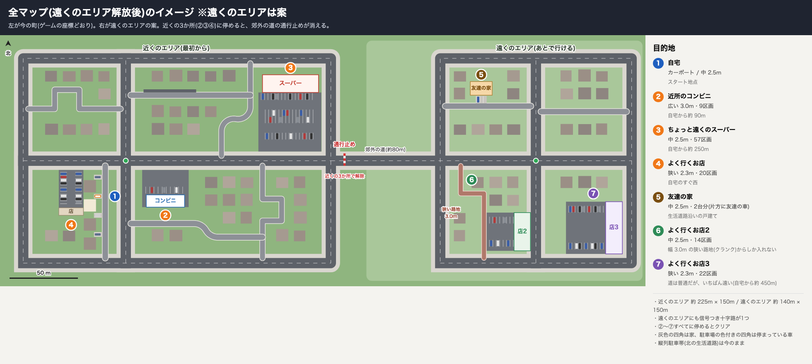

# 駐車シミュレーター

駐車の練習ができる運転シュミレーターです。

楽しく遊んで、車の動きを覚えよう！

## 起動方法

ビルド成果物はリポジトリに含めていないため、Unityをインストールしてビルドを行い、ビルドをする必要があります。

### Unity のインストール

1. [Unity Hub](https://unity.com/download) をインストールし、Unity ID でサインインする(Personal ライセンスで使えます)
2. Unity Hub の **Installs → Install Editor** で **6000.0.56f1** をインストールする
   - 一覧に無い場合は [Unity のダウンロードアーカイブ](https://unity.com/releases/editor/archive) の 6000.0.56f1 から Unity Hub で開く
   - Mac で Windows 用に(またはその逆に)ビルドしたいときは、モジュールの **Windows Build Support (Mono)** / **Mac Build Support (Mono)** も追加する

### Unity エディタで遊ぶ

1. Unity Hub で `parking-simulator` フォルダを開く(Built-in レンダーパイプライン)
2. `Assets/Scenes/ParkingSimulator.unity` を開いて ▶ 再生
   - シーンが無い場合はメニュー **Parking Simulator → シーンを作成して開く**
   - 空のシーンで再生しても自動でシミュレーターが起動します
3. 単体アプリにする場合: メニュー **Parking Simulator → Mac 用にビルド / Windows 用にビルド**(`Builds/` に出力)

### ターミナルでビルドする

エディタの画面を開かずに、単体アプリを `Builds/` に出力できます。プロジェクトを Unity エディタで開いている間は動かないので、閉じてから実行してください。初回は `Library/` の作成に数分かかります。

Mac(`Builds/Mac/ParkingSimulator.app` に出力):

```sh
cd parking-simulator
/Applications/Unity/Hub/Editor/6000.0.56f1/Unity.app/Contents/MacOS/Unity \
  -batchmode -quit -projectPath . \
  -executeMethod ParkingSim.EditorTools.ParkingSimEditor.BuildMac \
  -logFile -
open Builds/Mac/ParkingSimulator.app
```

Windows(PowerShell、`Builds/Windows/ParkingSimulator.exe` に出力):

```powershell
cd parking-simulator
& "C:\Program Files\Unity\Hub\Editor\6000.0.56f1\Editor\Unity.exe" `
  -batchmode -quit -projectPath . `
  -executeMethod ParkingSim.EditorTools.ParkingSimEditor.BuildWindows `
  -logFile build.log
.\Builds\Windows\ParkingSimulator.exe
```

- Mac 版を Windows で、Windows 版を Mac で作るときは、`BuildMac` / `BuildWindows` を入れ替える(対応するモジュールが必要)
- ビルドに失敗すると終了コード 1 で終わります。原因はログ(Mac は画面、Windows は `build.log`)の `error` を探してください

Joy-Con (L)+(R) を Bluetooth でつなぐか、キーボードで操作します。プロコンなどのゲームパッドも Joy-Con と同じ配置で使えます(+ = スタートボタン、− = セレクトボタン)。

## 車

SUBARU インプレッサスポーツ の第5世代のモデルをベースに作成しています。

| 項目 | 値 |
|---|---|
| 型式 | 3BA-GT2(F54C)FF / リニアトロニック(CVT)、2021年12月以降のモデル |
| 色 | クリスタルホワイト・パール |
| エンジン | FB16 水平対向4気筒 1,599cc 115PS / 6,200rpm、148N·m / 3,600rpm |
| 全長 × 全幅 × 全高 | 4,475 × 1,775 × 1,480 mm |
| ホイールベース / トレッド(前・後) | 2,670 / 1,540・1,545 mm |
| 最小回転半径 | 5.3 m(ハンドルいっぱいで外側前輪がえがく円の半径) |
| 車両重量 | 1,300 kg |
| タイヤ | 205/55R16(17インチ車は 205/50R17。どちらかは未確認で、16インチとして作っています) |

オーバーハングの前後配分(前 1,005mm)、ステアリングギア比(13.0)、ミラーを含む幅、運転席の目の位置は公表値が見つからないための想定値です。すべて `Assets/ParkingSimulator/Scripts/CarSpec.cs` で変更できます。

車の動きは後輪中心の二輪モデル(低速の運動学モデル)で計算し、前輪はアッカーマン配置で切れます。

## 遊び方

1. 自宅のカーポートに、シフト P で停まった状態から始まります。
2. マップ(カーナビ)で目的地を選びます。選ばずに好きなところへ走ってもかまいません。
3. 目的地を選ぶと、カーナビが経路を案内します。
4. どこかの駐車枠に収まった状態で P に入れると「到着」です。駐車回数と総走行距離を表示します。

### 到着

- P に入れた瞬間に、車体の四隅がすべて駐車枠(白線の内側)に入っていれば到着です。駐車回数が1増えます。
- 車体の一部だけが枠に入っているときは「車体が枠からはみ出しています」と出ます。それ以外の場所で P に入れても何も出ません。
- 目的地に選んでいたかどうか、自宅かどうかに関係なく数えます。マップでの選択は、カーナビの行き先の設定にすぎません。
- 同じ場所で P に入れ直して回数を稼げないよう、前回の駐車から 3m 以上走ったときだけ数えます。
- 表示は、車が動き出すか、P 以外に入れるか、A(Enter)を押すと閉じます。

### 接触と縁石

- 車体やミラーが他の車・壁・柱・建物に当たると「接触しました」と知らせ、車がその場で止まります。警告音は3秒で止まります。
- 縁石や歩道は事故扱いになりません。タイヤが乗り上げて車体が傾き、速度が落ちます。

### 目的地

| 場所 | 駐車スペース | 説明 |
|---|---|---|
| 自宅 | 中(幅 2.5m) | 戸建てのカーポート。生活道路から直接入る。スタート地点 |
| 近所のコンビニ | 広い(幅 3.0m)・9区画 | 中央の十字路の南東 |
| ちょっと遠くのスーパー | 中(幅 2.5m)・57区画 | 町の北東。4列の大きな駐車場 |
| よく行くお店 | 狭い(幅 2.3m)・20区画 | 自宅の西。両側にブロック塀があり、車間が狭い |

- 駐車枠の奥行きはどれも 5.0m、枠の幅は白線の中心間の寸法です。
- 駐車場には他の車がまばらに停まっていて、空いている枠に停めます。
- 目的地にした場所の空いている枠は、オレンジの枠と薄い塗りで少し目立ちます。
- 縦列駐車帯(北の生活道路、5台分)も駐車枠として数えます。

### 遠くのエリア(準備中)

近くの3か所(コンビニ・スーパー・よく行くお店)に一度ずつ停めると、町の東の通行止めが消えて遠くのエリアに行ける仕組みです。自宅以外の全部の場所に一度でも停めるとクリアで、クリア後も自由に走れます。

遠くのエリア(友達の家・よく行くお店2・よく行くお店3)はまだ作っていません。配置の案は [docs/images/full_map_plan.png](docs/images/full_map_plan.png) にあります。



## 町

時間が止まった町で、自分だけが運転できる設定です。歩行者や走っている車はいません(停まっている車はあります)。

- 町は外周道路(約 225m × 150m)で囲まれ、行き止まりはありません。中央の十字路のほかはすべて T字路です。
- **幹線道路**: 外周道路と、町を東西・南北に貫く2本の道路。片側1車線・左側通行・歩道あり。中央の十字路には信号機(消灯)・横断歩道・停止線があります。路上駐車の車も数台います。
- **生活道路**(1車線・両側に縁石): 各ブロックを抜ける細い道です。
  - S字の抜け道(北東、道幅 3.6m): 半径 9m の S字
  - クランクの路地(南東・北西、道幅 3.6m): 直角カーブが4つ
  - 北の生活道路(道幅 4m): 縦列駐車帯がある
  - コンビニ裏の生活道路・自宅前の生活道路(道幅 4m)

## 操作

Joy-Con とキーボードで同じ操作ができます。違いはスティックの角度(連続値)だけです。マウスは使いません。

| 操作 | Joy-Con | キーボード |
|---|---|---|
| アクセル / ブレーキ | A / B | W / S |
| ハンドル | 左スティック 左右 | A / D |
| ハンドル固定(もう一度で解除) | ZL | Space |
| シフト P→R→N→D / D→N→R→P | R / L | E / Q |
| 見渡す | 右スティック | 矢印キー |
| 視点切替 | ZR | V |
| マップ | − | M |
| メニュー | + | Esc |
| (画面内)選ぶ / 決定 / 戻る | 左スティック・十字 / A / B | 矢印・WASD / Enter・Space / Backspace |

- **ペダル**: ボタンなので、押している間に踏み込み量が増え、離すと戻ります。
- **シフト**: ブレーキを踏む必要はありません。走行中の危険な切り替え(動いている間の P、前進中の R、後退中の D)だけ受け付けません。計器の P R N D の左右に「L / Q ◀」「R / E ▶」を出して、キーとシフトが動く向きの対応を示しています。
- **クリープ**: D / R でブレーキを離すとゆっくり進む(前進 約6km/h・後退 約5km/h)現象です。初期設定は OFF で、メニューで ON にできます。
- **マップ**: 止まっているときだけ開けます。

### ハンドル

- スティックを倒した角度がハンドルの目標角になり、ハンドルはその角度まで現実的な速さ(約 540°/秒)で回ります。キーは押している間、いっぱいまで回ります。
- 離すと中央へ徐々に戻ります(走っているほど速く戻ります)。
- ZL(Space)で今の角度に固定できます。固定中は手を離しても角度を保つので、駐車に専念できます。
- 固定は、もう一度 ZL(Space)を押すか、スティック(キー)をいったん離してから倒し直すと解除されます。倒し直した場合は、そのまま新しい角度へつかみ直します。
- 片側の最大はハンドル約 455°(ロック・トゥ・ロック 約 2.5 回転)です。

## 視点

ZR(V)で 車外の三人称(最初の視点)→ 運転席 → 真上からの 2D → 車外の三人称 の順に切り替わります。

| 視点 | 見渡す操作(右スティック / 矢印キー) |
|---|---|
| 車外の三人称 | 上下で仰角(離してもそのまま)、左右で回り込み(離すと後方に戻る)。建物などで車が隠れるときは自動で高い位置から映す |
| 運転席 | 倒している間その方向を見る。離すと正面に戻る。右ハンドルの運転席の目線で、ピラー・ダッシュボード・ハンドル(12時に橙の目印)がある。ドアミラー2面とルームミラーを画面に拡大表示。R に入れるとドアミラーが下を向く |
| 2D | 真上から見下ろす。上下でズーム。車の向きが常に画面の上 |

## 補助表示

| 表示 | 内容 |
|---|---|
| 予想進路線 | 今のハンドル角で進んだときの車体の四隅の軌跡を、地面に常に描く(黄 = 進む側の角、水色 = 反対側の角)。R のときは後ろ、それ以外は前へ進んだときの線 |
| バックカメラ | R のとき、車外と運転席の視点で表示。距離の目安線(0.5m 赤 / 1m 黄 / 2・3m 緑)と、ハンドルに連動するガイド線つき |
| 距離センサー | 前後各4個。D で約 10km/h 未満のときは前、R のときは前後が働き、画面右下に近さを表示 |
| 他の車などとの距離(3D) | メニューで ON にすると、1.2m 以内の他の車・壁・柱について、車体との一番近い点を線で結び cm で表示する(初期設定は OFF) |

## カーナビ

- 目的地を選ぶと、道の中心線のつながりから最短の経路を計算し、マップに経路の線を引きます。入口が複数ある場所は、近い方の入口へ案内します。
- 案内の行き先は、道路から敷地に入ったところです。駐車場の中は案内しません。
- 経路で向きが 35° 以上変わる所を右左折とし、画面右上に次の曲がり角の向き(矢印)、そこまでの道のり、目的地までの道のりを出します。
- 音声で読み上げます(macOS は日本語音声 Kyoko、Windows は OS の音声合成)。

| 場面 | 読み上げ |
|---|---|
| 目的地を決めたとき | 「ルート案内を開始します。」に続けて、次の案内 |
| 次の曲がり角まで 150m より遠いとき | 「この先、およそ○メートル直進です。」 |
| 曲がり角まで 120m 以内 | 「およそ○メートル先、右方向です。」 |
| 曲がり角まで 25m 以内 | 「まもなく右方向です。」 |
| 入口まで 40m 以内 | 「まもなく目的地です。」(手前に曲がり角があれば「まもなく左方向、その先が目的地です。」) |
| 入口に着いたとき | 「目的地に到着しました。案内を終了します。」 |

## メニュー

+(Esc)で開きます。開いている間は、ゲームの時間と音(エンジン音・音声案内も)が止まります。

| 項目 | 内容 |
|---|---|
| 運転に戻る | |
| 車の選択 | 3つの枠があり、1つ目がインプレッサ(外観のプレビューと諸元を表示)。残り2つは空き |
| クリープ現象 | ON / OFF(初期設定 OFF) |
| センサー音 | ON / OFF |
| 他の車などとの距離(3D) | ON / OFF(初期設定 OFF) |
| 音量 | 0〜100%(カーナビの読み上げにも効く) |
| 操作説明 | Joy-Con とキーボードの操作の一覧 |
| 自宅に戻る | 自宅のカーポートに P で停まった状態に戻す |
| 記録をリセット | 2回決定するとリセット |
| ゲームを終了 | |

メニューの上には、駐車回数・総走行距離・到着した場所の数が出ます。

## 記録

駐車回数・総走行距離・到着した場所・クリア済みかどうかと、メニューの設定を `save.json`(`Application.persistentDataPath`)に保存します。

## 音

音声ファイルは使わず、すべてその場で合成しています。

| 音 | 内容 |
|---|---|
| エンジン | ごく小さなこもったアイドル音(水平対向4気筒の燃焼のリズム)。アクセルを踏んでも吹かす音は出さない |
| 走行 | CVT のかすかなうなりとロードノイズ(速度に比例) |
| ブレーキ | 急ブレーキ(踏み込み 75% 以上、約 5km/h 以上)のときだけ「キーッ」と鳴く。普段のブレーキは無音 |
| 距離センサー | ベル調の短い音。前のセンサーは高め、後ろは低め。近いほど間隔が短くなり、30cm 未満で連続音 |
| 接触 | 連続音。3秒で止まる |
| R のお知らせ | 約 1 秒ごとの「ポーン」。センサーが鳴っている間は鳴らさない |

## 構成

```
Assets/ParkingSimulator/
  Scripts/
    CarSpec.cs            車両の諸元と運動学(後輪中心の二輪モデル、アッカーマン)
    CarController.cs      ペダル・CVT のクリープ・シフト・ハンドル・接触と縁石
    Controls.cs           操作の割り当て(Joy-Con とキーボードを1か所で)
    Pad.cs                Joy-Con / ゲームパッドの入力のまとめ
    JoyConHID.cs          Joy-Con の HID ドライバー(フル入力モードでスティックを読む)
    VehicleBuilder.cs     自車(外装・内装・ミラー・バックカメラ)と駐車中の他車
    World.cs              駐車枠・目的地(Place)・区域・経路案内用の道の定義
    WorldBuilder.cs       世界全体の生成
    TownBuilder.cs        町(幹線道路と交差点・生活道路・自宅・お店・コンビニ・スーパー・家並み)
    BuildKit.cs           白線・縁石・歩道・駐車区画の列などの部品
    Util.cs               生成の共通処理とレイヤー
    CameraRig.cs          車外 / 運転席 / 2D の視点とミラー
    PathGuide.cs          予想進路線
    ParkingSensors.cs     距離センサーと、接近・接触・R のお知らせ音
    Chime.cs              知らせる音の波形
    CarAudio.cs           エンジン・走行・ブレーキの音の合成
    ClearanceProbe.cs     他の車などとの距離(3D 表示用)
    ParkingCheck.cs       駐車枠に収まっているかの判定
    Navigator.cs          経路探索
    NavGuide.cs           曲がり角の案内と読み上げる文
    Speech.cs             OS の音声合成での読み上げ
    MapView.cs            町全体のマップ
    DestinationMarker.cs  目的地の空いている枠の強調表示
    SaveData.cs           記録と設定の保存
    HUD.cs                画面表示(計器・カーナビ・マップ・メニュー・車の選択・操作説明)
    GameManager.cs        全体の管理(画面の切り替え・到着・解放・カーナビ)
  Editor/ParkingSimEditor.cs   シーン作成・ビルド用メニュー
  Resources/                   ベースマテリアル、日本語フォント(BIZ UDPゴシック, SIL OFL 1.1)
```

外部アセットは使わず、車や町はすべて実行時にプリミティブから生成しています。

ビルドしたアプリを `-autoshot <フォルダ>` を付けて起動すると、主な画面のスクリーンショットを保存して終了します(動作確認用。記録は保存しません)。カーナビの案内文もログに出します。
